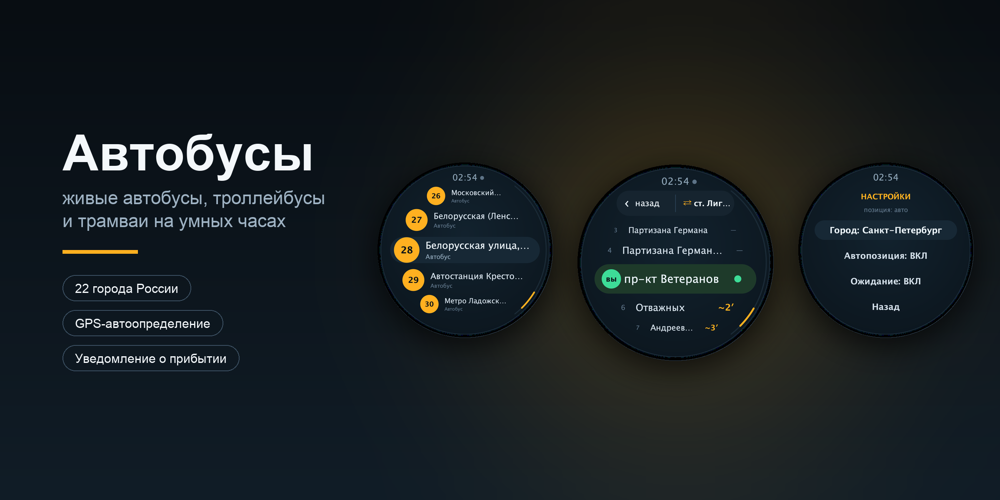
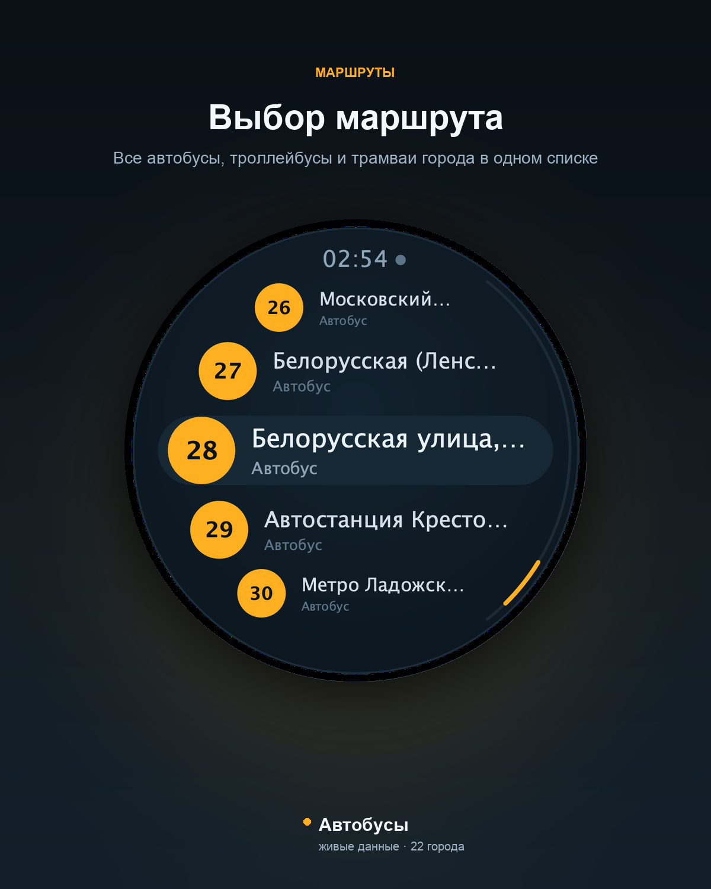
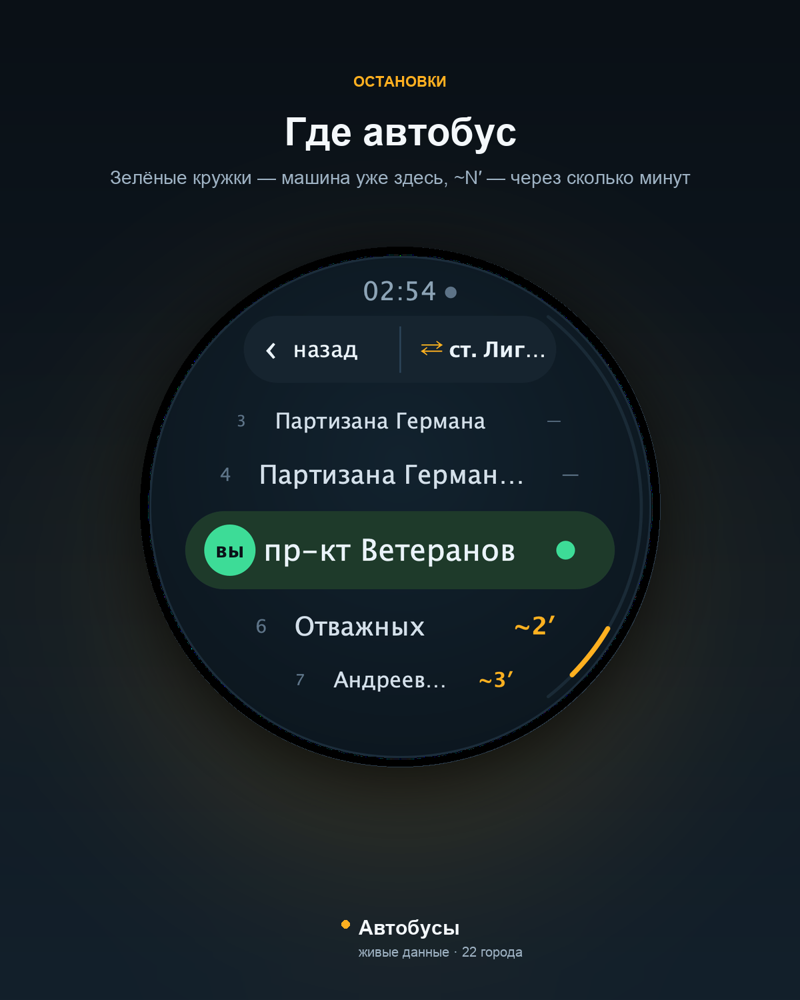
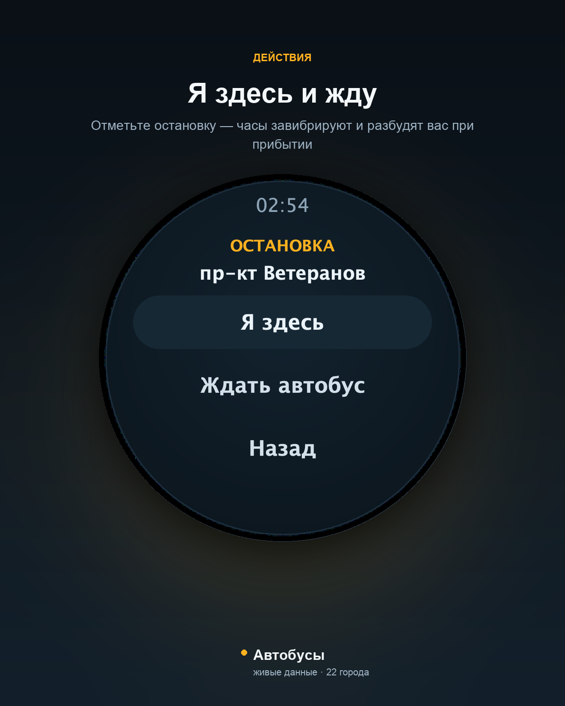
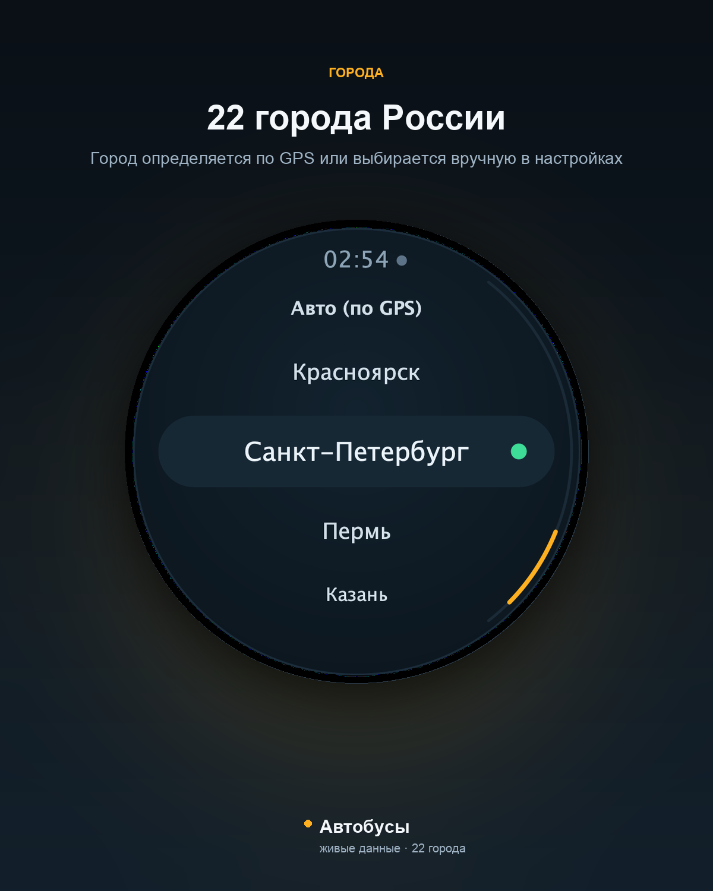
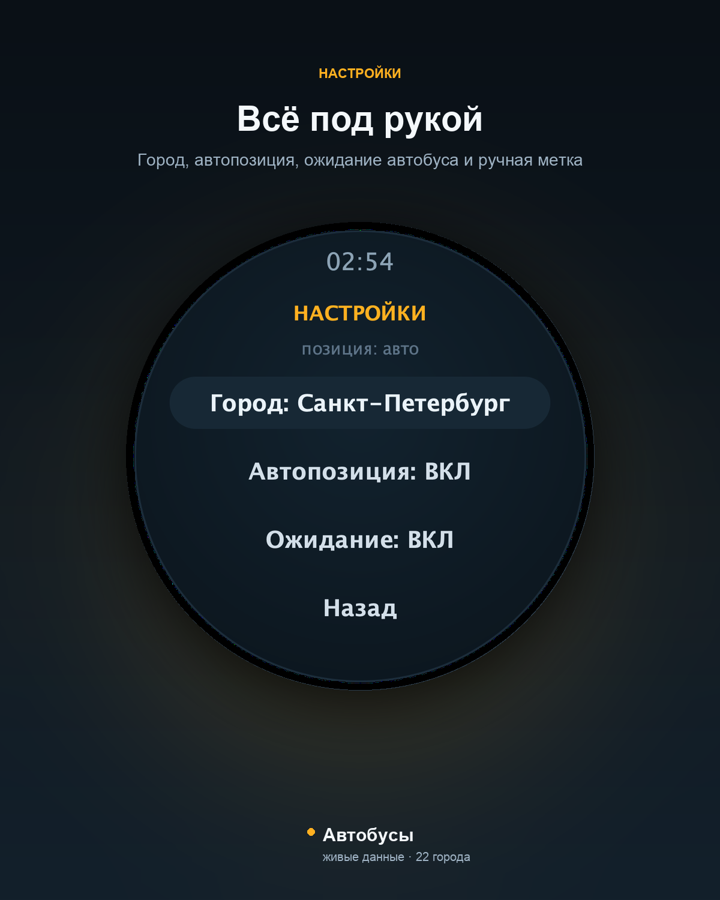
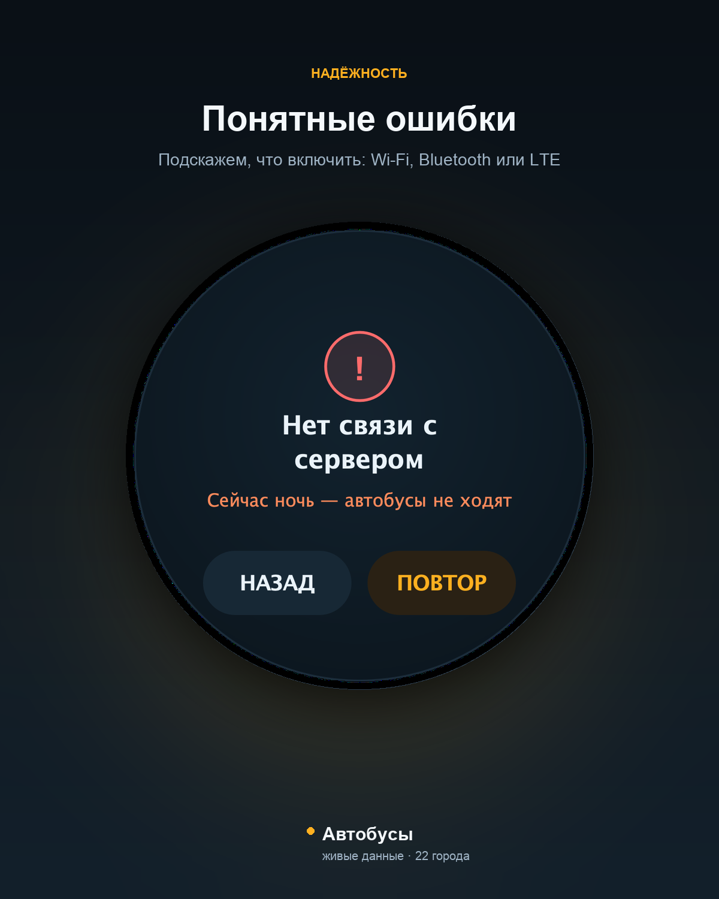

# Автобусы — приложение для умных часов

[](LICENSE)
[](#поддерживаемые-устройства)
[-3ddc84)](#сборка)

Открытое приложение для умных часов: **живые автобусы, троллейбусы и трамваи на
карте города**, полный список остановок маршрута, прогноз ожидания и вибро­уведомление
о прибытии — даже при выключенном экране.

Один APK работает на круглых экранах **360–480 px** (Wear OS 3/4/5 и
APK-совместимый HarmonyOS), город определяется по GPS автоматически.

<p align="center">
  
</p>

<p align="center">
  
  
  
  
</p>
<p align="center">
  
  
</p>

---

## Содержание

- [Возможности](#возможности)
- [Поддерживаемые устройства](#поддерживаемые-устройства)
- [Установка](#установка)
- [Полная инструкция релиза 1.70](#полная-инструкция-релиза-170)
- [Как это работает](#как-это-работает)
- [Сборка](#сборка)
- [Тестирование](#тестирование)
- [Структура проекта](#структура-проекта)
- [Данные и правовая заметка](#данные-и-правовая-заметка)
- [Планы](#планы)
- [Участие в проекте](#участие-в-проекте)
- [Лицензия](#лицензия)

## Возможности

**Маршруты и остановки**

- 22 города России; город выбирается в настройках или определяется по GPS
  (ближайший поддерживаемый в радиусе 250 км).
- Список маршрутов с fisheye-эффектом: центральная строка крупнее и шире, края
  сужаются по форме круга.
- Полный упорядоченный список остановок выбранного направления.
- Любую строку можно поставить точно в центр экрана.

**Живые данные**

- На экране остановок позиции обновляются каждые **3 секунды**, в фоне — каждые 5.
- На остановке показывается, что автобус **уже здесь** (зелёные кружки по числу
  машин) или через сколько минут он подойдёт (`~N′`).
- Ваша остановка помечена отдельным маркером.
- Переключение направления движения одной кнопкой.

**Уведомления**

- «Ждать автобус»: метка на остановке, двойная вибрация и уведомление при
  прибытии.
- Foreground-сервис, wake-lock и сторожевой будильник держат ожидание живым при
  погашенном экране и в Doze; лимит — 3 часа.
- Одна машина — один кружок: дубликаты фида не «троят» индикатор.
- В уведомлении показывается публичный номер маршрута («2»), а не внутренний id.

**Управление и интерфейс**

- Вращающееся колёсико, свайпы, касания; быстрое пролистывание с инерцией.
- Свайп влево — желаемые маршруты, вправо — назад.
- Круглый интерфейс, вписанный в радиус 112 dp; ночной режим с пояснением.
- Ручная позиция «Я здесь» и отключаемое автоопределение.
- Экран ошибки с кнопками «НАЗАД» и «ПОВТОР» и подсказкой про Wi-Fi/Bluetooth/LTE.

## Поддерживаемые устройства

| Платформа | Модели | Сборка |
|---|---|---|
| Wear OS 3/4/5 | Pixel Watch 1–3, Galaxy Watch 4–7/FE, Xiaomi Watch 2/2 Pro, OnePlus Watch 2/2R, TicWatch Pro 5, Fossil Gen 6 | `models/wear-os/` |
| HarmonyOS 2–4 | Huawei Watch 3/3 Pro, Watch 4/4 Pro (APK-совместимые прошивки) | `models/harmonyos/` |
| HarmonyOS NEXT 5 | Huawei Watch 5 | `models/harmonyos-next/` (HAP, DevEco Studio) |
| Tizen 5.5 | Samsung Galaxy Watch 3 | `models/samsung-galaxy-watch-3/` |
| Fitbit OS 5 | Versa 3/4, Sense/Sense 2 | `models/fitbit/` |
| Android APK | Huawei Watch 3 Pro (основная сборка) | `versions/v1.70/` |

Полная матрица с разрешениями и версиями ОС — в [docs/DEVICES.md](docs/DEVICES.md).
Закрытые RTOS (Xiaomi Watch S1/S3, OnePlus Watch 1, Amazfit, Garmin) APK не
запускают — для них нужен отдельный нативный порт. Fitbit использует собственный
Fitbit OS SDK — см. `models/fitbit/`.

## Установка

```bash
# Huawei Watch 3 Pro / APK-совместимые
adb install -r versions/v1.70/KrskBusWatch-1.70.apk

# Wear OS
adb install -r models/wear-os/dist/KrskBusWatch-wear-1.70.apk
```

Нужен Android 8.0+ (API 26). На часах включите отладку по ADB, разрешите
геопозицию и уведомления.

## Полная инструкция релиза 1.70

Версия **1.70** — стабильный релиз для публикации на GitHub. APK проверен на
целостность и подписью `apksigner`. Исходники, скрипты и changelog находятся в
репозитории проекта, а основной файл релиза —
`versions/v1.70/KrskBusWatch-1.70.apk`.

### 1. Huawei Watch 3 Pro — основная Android APK-сборка

Подходит для Huawei Watch 3 Pro и других APK-совместимых часов на HarmonyOS 2–4.

**Установка через ADB**

1. Включите на часах режим разработчика: откройте сведения об устройстве и
   нажмите «Номер сборки» семь раз.
2. Включите «Отладку по ADB» или «Отладку по Wi‑Fi».
3. Подключите часы к компьютеру и проверьте соединение:

```bash
adb devices
adb install -r versions/v1.70/KrskBusWatch-1.70.apk
```

4. При первом запуске разрешите доступ к геопозиции и уведомлениям.
5. Если установка поверх старой версии завершается ошибкой подписи, удалите
   приложение и установите его заново:

```bash
adb uninstall ru.krsk.buswatch
adb install versions/v1.70/KrskBusWatch-1.70.apk
```

Включите автозапуск и работу в фоне в настройках батареи Huawei, если функция
«Ждать автобус» прекращается после выключения экрана.

### 2. Wear OS 3, 4 и 5

Поддерживаются Pixel Watch 1–3, Galaxy Watch 4–7/FE, Xiaomi Watch 2/2 Pro,
OnePlus Watch 2/2R, TicWatch Pro 5 и Fossil Gen 6.

Для Wear OS используется отдельная сборка с `targetSdk 34`, обязательным
watch-профилем и поддержкой автономной работы часов. APK нужно собрать из
`models/wear-os/`:

```bash
cd models/wear-os
JAVA_HOME=/tmp/jdk17home ./build.sh
# результат: dist/KrskBusWatch-wear-1.70.apk
```

**Установка**

1. На часах откройте «Настройки → Система → Сведения» и нажмите «Номер сборки»
   семь раз.
2. Включите «Отладку по ADB» и, при необходимости, «Отладку по Wi‑Fi».
3. Подключите часы и выполните:

```bash
adb devices
adb install -r dist/KrskBusWatch-wear-1.70.apk
```

Для чистой установки:

```bash
adb uninstall ru.krsk.buswatch
adb install dist/KrskBusWatch-wear-1.70.apk
```

После запуска разрешите геопозицию и уведомления. На Wear OS 4/5 проверьте также
разрешение уведомлений и отсутствие ограничений фоновой работы.

### 3. HarmonyOS 2, 3 и 4 — APK-совместимые часы Huawei

Поддерживаются Huawei Watch 3/3 Pro и Watch 4/4 Pro на APK-совместимых
прошивках. Эта сборка также может устанавливаться на телефоны Huawei с
HarmonyOS 2–4.

Сборка:

```bash
cd models/harmonyos
JAVA_HOME=/tmp/jdk17home ./build.sh
# результат: dist/KrskBusWatch-harmony-1.70.apk
```

Установка на часы или телефон:

```bash
adb devices
adb install -r dist/KrskBusWatch-harmony-1.70.apk
```

Для ошибки `INSTALL_FAILED_UPDATE_INCOMPATIBLE` выполните `adb uninstall
ru.krsk.buswatch`, затем повторите установку. В настройках Huawei разрешите
автозапуск, работу в фоне, геопозицию и уведомления.

### 4. HarmonyOS NEXT 5 — Huawei Watch 5

HarmonyOS NEXT **не запускает Android APK**. Для Huawei Watch 5 требуется
нативный HAP-пакет, собранный в DevEco Studio с подписью, связанной с Huawei ID.
Готового HAP в релизе 1.70 нет.

1. Установите DevEco Studio 5.0+.
2. Создайте проект `Application → Empty Ability`, язык ArkTS, API 12, профиль
   Wearable.
3. Скопируйте `models/harmonyos-next/BusModel.ets` и `Index.ets` в проект.
4. Добавьте разрешения INTERNET, LOCATION, VIBRATE и
   KEEP_BACKGROUND_RUNNING из `models/harmonyos-next/README.md`.
5. Включите автоматическую подпись в `Project Structure → Signing Configs`.
6. Соберите HAP через `Build → Build Hap(s)/App(s)`.
7. Установите пакет на часы:

```bash
hdc install entry/build/default/outputs/default/entry-default-signed.hap
```

### 5. Samsung Galaxy Watch 3 — Tizen 5.5

Galaxy Watch 3 работает на Tizen, поэтому Android APK и Wear OS APK на нём не
устанавливаются. Нужен веб-пакет `.wgt` из `models/samsung-galaxy-watch-3/`.

1. Установите Tizen Studio 4.6+ с расширениями Wearable и Samsung Certificate
   Extension.
2. В `Tools → Certificate Manager` создайте сертификат Samsung.
3. Соберите проект:

```bash
cd models/samsung-galaxy-watch-3
./build.sh
```

4. Подпишите пакет профилем сертификата в Tizen Studio (`Project → Build Signed
   Package`).
5. На часах включите режим разработчика и отладку по Wi‑Fi, затем подключитесь:

```bash
sdb connect <IP-часов>:26101
sdb install KrskBusWatch-tizen-1.0.0-signed.wgt
```

Фоновое ожидание на текущем Tizen-порту работает только пока приложение открыто;
это ограничение Tizen Web App.

### 6. Fitbit OS 5 — Versa 3/4 и Sense/Sense 2

Fitbit использует отдельный JavaScript/SVG-порт. APK на эти часы не ставится.
Готовый `.fba` не входит в релиз: для сборки нужны официальный Fitbit SDK и
учётная запись разработчика.

```bash
cd models/fitbit
npm install
npm run build
# результат: build/fitbit.fba
```

Установка выполняется через Fitbit Developer Bridge:

1. В приложении Fitbit включите режим разработчика.
2. Выполните `npx fitbit`.
3. Выберите `connect device`, затем `install`.

Уведомления и ожидание автобуса на Fitbit работают только пока приложение
активно, поскольку Fitbit OS ограничивает фоновые приложения.

## Разрешения и первый запуск

При первом запуске разрешите:

- **Интернет** — загрузка маршрутов и позиций транспорта;
- **геопозицию** — выбор ближайшего города и остановки;
- **уведомления** — сообщение о прибытии автобуса;
- **вибрацию** — сигнал ожидания;
- **фоновую работу и wake lock** — ожидание при выключенном экране.

В приложении можно выбрать город вручную, включить «Я здесь», выбрать маршрут,
остановку и пункт «Ждать автобус». Настройки направления прокрутки и размера
интерфейса сохраняются между запусками.

## Сборка и проверка релиза 1.70

Требуются JDK 17, Android Build-Tools 34 и Android Platform 33:

```bash
./run_tests.sh
./build_apk.sh
```

Ожидаемый результат тестов стабильного исходного дерева: **319 passed, 0 failed**.
После сборки проверьте APK:

```bash
unzip -tq versions/v1.70/KrskBusWatch-1.70.apk
$BUILD_TOOLS/apksigner verify --print-certs versions/v1.70/KrskBusWatch-1.70.apk
```

Для публикации на GitHub используйте тег `v1.70`, файл
`versions/v1.70/KrskBusWatch-1.70.apk` и changelog из
`versions/v1.70/CHANGELOG.md`.

## Как это работает

```
UI (Android)                     Логика (чистая Java, тестируется на хосте)
├── WatchView  ── рисует UiFrame ├── Geo, Text, Displays
├── WatchUi    ── строит кадр    ├── Board (остановки и прогноз)
├── BusWatchActivity ─ состояние ├── Catalog, Cities, RoutePageParser
└── BusAlertService ─ фон        ├── FeedParser, MiniJson, Fling
                                 └── Alert, Selection, FocalList, RouteList
```

- Интерфейс описан списком примитивов `UiFrame`: его проигрывает и Android
  `Canvas`, и Java2D-рендерер тестов — поэтому вёрстку можно проверять без
  эмулятора.
- Геометрия fisheye (`FocalList`, `RouteList`) используется и для отрисовки, и
  для попаданий пальцем.
- Каталог города лежит в `assets`; упорядоченные остановки для Красноярска
  зашиты офлайн, для остальных городов читаются со страницы маршрута и кэшируются.
- Живой фид опрашивается раз в 10 секунд в фоновом потоке.

Подробнее: [docs/ARCHITECTURE.md](docs/ARCHITECTURE.md).

## Сборка

Нужны **JDK 17**, **Android Build-Tools 34** и **Platform android-33**
(пути задаются переменными `JAVA_HOME`, `BUILD_TOOLS`, `PLATFORM_DIR`).

```bash
./build_apk.sh        # → versions/v1.70/KrskBusWatch-1.70.apk
./run_tests.sh        # 319 проверок + рендеры экранов
./run_tests.sh --live # + живая проверка фида
```

Gradle намеренно не используется: сборка — это `aapt2` + `javac` + `d8` +
`apksigner`, поэтому проект собирается на любой машине с SDK и без Android Studio.

## Тестирование

- **319 юнит-тестов** без эмулятора: геодезия, прогноз прибытия, парсеры фида и
  страниц маршрутов, города, fisheye-геометрия, масштабирование экранов,
  инерционная прокрутка, детектор прибытия.
- **UI-тесты**: интерфейс рендерится в PNG и автоматически проверяется, что весь
  текст и кнопки вписаны в круг.
- **Живой тест**: реальный фид Красноярска и страница маршрута Москвы.
- **CI**: `.github/workflows/build.yml` — тесты, сборка APK и артефакты.

## Структура проекта

```
app/                 исходники приложения и assets (22 города)
app/tests/           хост-тесты: логика, UI-рендеры, живой фид
versions/vX.Y/       релизы: APK + CHANGELOG каждой версии
models/              сборки по моделям часов (Wear OS, HarmonyOS, Tizen)
docs/                матрица устройств, архитектура, источники данных
docs/images/screenshots/  готовые скриншоты и баннер для публикации
tests/preview/       рендеры интерфейса (466×466, 360, 480)
tools/               скрипты сбора каталога
data/                исходные выгрузки
.github/workflows/   CI: тесты + сборка APK
```

## Фоновая работа

Режим ожидания переживает выключение экрана благодаря foreground-сервису,
wake-lock и сторожевому будильнику `setAndAllowWhileIdle`. Что разрешить на часах
и что делать, если уведомление не приходит, — в [docs/BACKGROUND.md](docs/BACKGROUND.md).

## Данные и правовая заметка

Источник — публичный веб-фид **Bustime** (`busti.me`): маршруты, остановки и
позиции машин. Подробности и правовая заметка — в [docs/DATA.md](docs/DATA.md).

Проект **не является официальным продуктом Bustime** и операторов транспорта;
данные используются в ознакомительных целях. Перед публикацией в магазинах
приложений уточните условия использования данных у правообладателя.

## Планы

- [x] 22 города и автоопределение по GPS
- [x] Wear OS, HarmonyOS, Tizen
- [x] Уведомление о прибытии в фоне
- [ ] Виджет/циферблат с ближайшим автобусом
- [ ] Избранные маршруты
- [ ] Локализация интерфейса (EN)
- [ ] Собственный HAP для HarmonyOS NEXT

## Участие в проекте

Issues и pull requests приветствуются. Как собрать и что проверить перед PR —
в [CONTRIBUTING.md](CONTRIBUTING.md).

## Лицензия

[MIT](LICENSE).

---

## Публикация на GitHub

Полный чек-лист, тексты для магазинов и состав пакета — в
[docs/PUBLICATION.md](docs/PUBLICATION.md). Текст релиза 1.70 —
[versions/v1.70/CHANGELOG.md](versions/v1.70/CHANGELOG.md).

**About (краткое описание репозитория):**

> Автобусы, троллейбусы и трамваи на умных часах: живые позиции, остановки,
> прогноз ожидания и виброуведомление о прибытии. Wear OS, HarmonyOS, Tizen.
> 22 города России. Открытый исходный код, MIT.

**Topics:**

```
wearos harmonyos tizen smartwatch android bus transport realtime
kotlin-free java public-transport krasnoyarsk russia watchface hacktoberfest
```

**Рекомендуемые настройки репозитория:**

- Description — текст выше, Website — пусто или страница релизов;
- Releases — теги `v1.70`, `v1.67`, … с APK из `versions/`;
- Topics — список выше;
- Social preview — `docs/images/screenshots/github-banner.png`.
